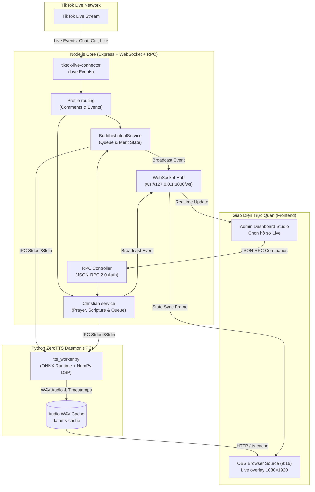

# Tam Thế Studio — TikTok Live cho hồ sơ Phật giáo và Thiên Chúa giáo

[](https://nodejs.org/)
[](https://expressjs.com/)
[](https://github.com/websockets/ws)
[](https://vitejs.dev/)
[](https://www.typescriptlang.org/)
[](https://www.python.org/)
[](https://github.com/astral-sh/uv)
[](https://huggingface.co/zeroweight-ai/ZeroTTS)
[](https://obsproject.com/)

**Tam Thế Studio** là ứng dụng điều khiển buổi phát TikTok Live theo khung dọc **9:16 (`1080×1920`)**, dùng với **OBS Studio** hoặc **TikTok LIVE Studio**. Ứng dụng có hai hồ sơ độc lập: **Phật giáo** và **Thiên Chúa giáo**; mỗi hồ sơ có giao diện, nội dung, tài nguyên và dữ liệu riêng. Node.js phục vụ máy chủ, Vite/TypeScript dựng giao diện, còn ZeroTTS tạo giọng đọc tiếng Việt.

Người xem có thể bình luận, thả tim, theo dõi, chia sẻ hoặc tặng quà để tạo tương tác trong hồ sơ đang phát. Thư viện `tiktok-live-connector` là thư viện không chính thức để nhận sự kiện từ phòng Live; ứng dụng không cấp quyền phát cho tài khoản TikTok.

Xem [hướng dẫn vận hành Live](docs/live-operations.md) để thiết lập token, nguồn OBS, âm thanh, kết nối TikTok và dữ liệu thử. Các kiểm tra tự động dùng dữ liệu mẫu; cần thử với phòng Live thật và thiết bị người xem để xác nhận đường truyền hình/tiếng.

### Hồ sơ Live

Studio có hai hồ sơ độc lập, dùng chung bộ máy TikTok Live, OBS và ZeroTTS:

| Hồ sơ | Quản lý | Xem Live | OBS Browser Source |
| --- | --- | --- | --- |
| Phật giáo | `/admin?profile=phat-giao` | `/?profile=phat-giao` | `/?profile=phat-giao&obs=1` |
| Thiên Chúa giáo | `/admin?profile=thien-chua-giao` | `/?profile=thien-chua-giao` | `/?profile=thien-chua-giao&obs=1` |

Các URL trên dùng máy chủ local `http://127.0.0.1:3000`; khi chạy `npm run dev`, đổi cổng thành `5173`. `obs=1` ẩn giao diện điều khiển để dùng làm nguồn hình. Ảnh nền và dữ liệu của hai hồ sơ được lưu riêng. Mỗi thời điểm chỉ một hồ sơ kết nối tới phòng TikTok để tránh nhận và xử lý trùng sự kiện.

Hồ sơ Thiên Chúa giáo có tab **Nội dung & giọng đọc**: [100 lời suy ngẫm theo 10 chủ đề](docs/christian-reflections.md), chọn ngẫu nhiên tránh lặp, chỉnh lời và nghe thử bằng cùng cài đặt ZeroTTS trước khi chia sẻ lên Live.

---

## Công nghệ

### 1. Backend & Networking Runtime
* **Node.js (`>=20.19` hoặc `>=22.12`)** và Express phục vụ giao diện, API, ZeroTTS worker và các kết nối realtime.
* **WebSocket (`ws`)** đồng bộ trạng thái giữa máy chủ, bảng điều khiển và màn phát; các lệnh điều khiển dùng JSON-RPC 2.0 qua `POST /rpc` hoặc WebSocket `/ws`.
* **tiktok-live-connector** nhận sự kiện từ phòng Live. Đây là thư viện không chính thức và cần tài khoản đang có quyền phát.

### 2. Frontend & Build Tooling
* **Vite** đóng gói bốn trang: Live và Admin cho mỗi hồ sơ.
* **TypeScript** kiểm tra các module giao diện qua `npm run typecheck`; hiệu ứng dùng Canvas 2D, CSS và Web Animations API. Tốc độ hiển thị phụ thuộc thiết bị và nội dung đang chạy.

### 3. AI Neural Voice (Text-to-Speech)
* **Python `3.10+`, Astral `uv` và ZeroTTS** chạy tổng hợp giọng tiếng Việt qua worker riêng. Danh sách giọng khả dụng được tải từ worker khi khởi động.

### 4. Live Streaming & Production Engine
* **OBS Studio** và **TikTok LIVE Studio** nhận màn Live qua trình duyệt, khung dọc `1080×1920`.
* **Web Audio API** phát giọng đọc và nhạc nền; nhạc được giảm âm khi giọng đọc phát.

---

## Sơ đồ luồng chính



---

## Tính năng

### Phật giáo
* Nhân vật đi lên điện, quỳ và thực hiện nghi thức Tam Bái bằng các sprite nhiều tư thế.

### Đạo tràng
* **194 Chỗ Thường**: Chia đều 2 bên chánh điện, tự động hiển thị Avatar thật của người xem TikTok khi họ bình luận hoặc tương tác.
* **6 Vị Trí VIP Bảng Vàng**: 6 đệm gấm đỏ thêu hoa sen vàng ngay trước Phật đài, vinh danh trực tiếp Top 6 thí chủ có điểm Công Đức cao nhất trong buổi phát sóng.
* **Làn Sóng Đạo Tràng**: Mỗi khi có tiếng chuông đại hồng chung hoặc đại lễ, toàn bộ hàng trăm Phật tử trên sàn gỗ đồng loạt cúi lạy tạo hiệu ứng uy nghiêm, xúc động.

### Giọng đọc và tương tác
* 8 giọng đọc AI tiếng Việt chân thực: *Bảo Trang, Gia Huy, Hà My, Hữu Đức, Kim Oanh, Mai Chi, Quang Minh, Tiến Đạt*.
* Hỗ trợ chế độ **Luân phiên giọng đọc**: Mỗi tương tác sử dụng một giọng kế tiếp nhau, tạo cảm giác như có nhiều vị Phật tử cùng đọc lời khấn.
* Hệ thống 30 câu dẫn nghi thức sáng tác riêng biệt cho từng hành động tâm linh.

### Xin xăm
* Bộ 100 quẻ chiêm nghiệm Phật giáo nguyên bản chia đều theo 5 chủ đề: *Bình an, Tài lộc, Gia đạo, Trí tuệ, Duyên lành*.
* Hiệu ứng lắc ống xăm tre kèm âm thanh sống động; tờ Giải Quẻ tự động bung mở đồng bộ chính xác với thời điểm giọng đọc AI cất lên.

### Thiên Chúa giáo
* Gửi lời cầu nguyện, chia sẻ đoạn suy ngẫm Kinh Thánh, thắp nến, đổ chuông, tri ân, hiệp thông, chúc bình an và chào đón khách.
* Khách vào phòng được xếp chỗ theo thứ tự; nhân vật có thể đi lên gần cung thánh rồi trở về vị trí.
* Khi tới lượt, hoạt ảnh bắt đầu ngay mà không đợi ZeroTTS; thao tác mới vẫn chờ lượt đang chạy để cảnh không chồng lên nhau.
* Kho suy ngẫm có [100 lời theo 10 chủ đề](docs/christian-reflections.md); nội dung có thể chỉnh trước khi chia sẻ lên Live.

### Lọc bình luận
* Bộ lọc làm sạch tên và bình luận, giới hạn độ dài và loại một số nội dung spam/độc hại trước khi chuyển thành sự kiện.
* Chuẩn hóa Unicode giúp xử lý tên và bình luận nhất quán hơn khi hiển thị và đọc bằng TTS.
* Ứng dụng lọc bình luận rác và giới hạn tốc độ xử lý để giảm sự kiện lặp; không bảo đảm loại bỏ mọi nội dung độc hại hoặc tránh được mọi tình trạng quá tải.

---

## Tương tác Phật giáo

| Sự kiện TikTok Live | Điều kiện / Từ khóa nhận diện | Nghi thức tương ứng trên Chánh Điện | Điểm Công Đức |
| :--- | :--- | :--- | :---: |
| **Thả tim (Like)** | Từng đợt like từ người xem | Tiếng mõ gỗ trầm + Làn sóng Phật tử vái lạy | `+1` / tim |
| **Theo dõi (Follow) / Chia sẻ (Share)** | Thao tác follow hoặc share buổi live | Thỉnh Đại Hồng Chung ngân vang + Tỏa sóng âm vàng | `+10` |
| **Bình luận Thắp hương** | `thắp hương`, `dâng hương`, `bái phật`, `lạy phật`, `hương` | Phật tử bước lên thảm đỏ, quỳ đảnh lễ 3 lạy + Đọc tên & lời khấn | `+15` |
| **Bình luận Cầu nguyện** | `cầu ...`, `nguyện ...`, `nam mô`, `a di đà phật`, `bình an`, `chúc ...` | Bước lên đảnh lễ + Thả Đèn Hoa Đăng mang sớ khấn bay lên trời | `+10` |
| **Bình luận Xin xăm** | `xin xăm`, `gieo quẻ`, `rút quẻ`, `quẻ` | Lắc ống xăm tre + Mở tờ Giải Quẻ đồng bộ giọng đọc AI | `+10` |
| **Tặng quà Nhỏ (1–4 xu)** | Hoa hồng, Heart Me, Nốt nhạc... | Dâng Đài Hoa Sen Vàng + Thắp 3 nén hương + Đọc cảm tạ | `+20` / xu |
| **Tặng quà (5–9 xu/món)** | Theo giá từng món nhận từ TikTok | Đèn Lưu Ly + tiếng chuông | `+20` / xu |
| **Tặng quà (10–99 xu/món)** | Theo giá từng món nhận từ TikTok | Đèn Lưu Ly (10–19) hoặc Mâm Quả (20–99) + tiếng chuông | `+30` / xu |
| **Tặng quà Lớn ($\ge$ 100 xu)** | Quà đặc biệt $\ge$ 100 xu | **Đại Lễ Kim Long Chầu Phật**: Mưa hoa sen vàng, Hào quang vạn trượng, Chuông ngân vang | `+50` / xu |

Điểm và loại nghi thức của quà dựa trên giá **mỗi món**; tổng điểm nhân theo số lượng thực nhận. Một combo 100 món giá 1 xu vẫn dùng cấp quà 1 xu, không bị đổi cấp theo cách TikTok gom gói. Cấu hình quà theo ID chỉ đổi cách trình diễn. Bình luận thường không khớp từ khóa được chuyển thành dâng 1 nén hương (+5); cùng người gửi có cooldown 3,5 giây.

## Tương tác Thiên Chúa giáo

| Bình luận nhận diện | Hoạt động |
| --- | --- |
| `cầu nguyện`, `xin cầu`, `cầu bình an`, `xin Chúa` | Ghi lời nguyện và đưa sự kiện cầu nguyện vào Live. |
| `Kinh Thánh`, `Lời Chúa`, `suy ngẫm`, `xin kinh` | Chọn suy ngẫm theo chủ đề hoặc tham chiếu có trong thư viện. Tham chiếu ngoài thư viện sẽ được báo chưa hỗ trợ. |
| `thắp nến` | Thắp nến tạ ơn. |
| `đổ chuông`, `rung chuông` | Đổ chuông thánh đường. |
| `hiệp thông`, `đại lễ` | Hiệp thông đại lễ. |
| `tạ ơn`, `tri ân` | Dâng lời tri ân. |
| `bình an` (không kèm lời cầu/nguyện) | Gửi lời chúc bình an. |

Bình luận kích hoạt thao tác cách nhau ít nhất 3,5 giây/người; nếu gửi nhanh hơn, Live hiện thông báo chờ. Bình luận thường vẫn hiện bong bóng. Like/Follow/Share cập nhật thống kê và thông báo có tên/avatar; các sự kiện này dùng tương tác nhẹ. Khách mới có thẻ chào lần lượt kèm tên, avatar và lời chào. Hồ sơ không dùng điểm Công Đức.

Các cảnh nghi thức chạy tuần tự: nhóm cầu nguyện/nến/hiệp thông/bình an/tri ân giữ ít nhất 10 giây cho động tác, rồi 2,6 giây trở về chỗ đứng. Giọng đọc có mốc riêng và được chuẩn bị trước khi có thể; nếu worker đang khởi động, lượt hiện tại thử chờ tối đa 180 giây mà vẫn phát hình. Khi quá hạn, giao diện báo lượt chỉ phát hình; tiếng đến sau hạn bị bỏ. Người xem mới mở OBS sẽ tiếp tục ở đúng vị trí âm thanh theo mốc tiếng.

Các thao tác cũng có thể được khởi chạy từ **Thao tác phụng vụ nhanh** trong giao diện. Hồ sơ này thống kê lời cầu nguyện, chia sẻ Kinh Thánh, tri ân và quà; không dùng điểm Công Đức của hồ sơ Phật giáo. Sự kiện TikTok có thể thay đổi theo phiên bản connector và dữ liệu thực tế của phòng.

---

## 🚀 Hướng Dẫn Cài Đặt & Vận Hành

### 1. Yêu Cầu Hệ Thống
* **Hệ điều hành**: Windows 10/11, macOS, hoặc Ubuntu Linux.
* **Node.js**: Phiên bản `>= 20.19.0` hoặc `>= 22.12.0` (khuyên dùng Node.js 22 LTS).
* **Python**: Phiên bản `3.10+` kèm công cụ [`uv`](https://github.com/astral-sh/uv).
* **OBS Studio**: Bản 29+ (khuyên dùng bản 30+).

### 2. Cài Đặt Trong 1 Bước
Mở terminal tại thư mục dự án và chạy:

```bash
npm install
```
Lệnh này chạy `uv sync --locked` để tạo `.venv` và cài thư viện Python. Cần cài Python `3.10+` và `uv` trước. Trên Windows có thể dùng `setup.ps1` để chuẩn bị môi trường.

Nếu chỉ muốn chạy giao diện/máy chủ và chưa cần giọng đọc, có thể bỏ bước cài ZeroTTS:

```powershell
$env:TEMPLE_SKIP_ZEROTTS_SETUP = "1"
npm install
```

Trên macOS/Linux:

```bash
TEMPLE_SKIP_ZEROTTS_SETUP=1 npm install
```

ZeroTTS chưa hoạt động ở chế độ này; cài Python dependencies bằng `npm run setup:python` khi cần.

*(Tùy chọn trên Windows PowerShell: Bạn có thể chạy script `.\setup.ps1` để tự động kiểm tra và cấu hình toàn bộ).*

### 3. Tải Model Giọng Đọc ZeroTTS
Ở lần chạy đầu, có thể cho phép tải model đã ghim revision từ Hugging Face Hub. Model khoảng `900 MB`, được lưu trong `data/models/` để dùng lại. `npm run dev` tự bật quyền tải nếu chưa đặt biến; khi chạy production cần đặt biến trước khi khởi động:

* **Trên Windows PowerShell**:
  ```powershell
  $env:ZEROTTS_ALLOW_HUB_DOWNLOAD = "1"
  npm start
  ```
* **Trên macOS / Linux**:
  ```bash
  ZEROTTS_ALLOW_HUB_DOWNLOAD=1 npm start
  ```
Model (`~900 MB`) sẽ được lưu vào cache cục bộ `data/models/` cho các lần chạy sau mà không cần tải lại.

### 4. Token điều khiển

Nếu chưa đặt `TEMPLE_RPC_TOKEN`, server tạo token ngẫu nhiên và in trong terminal mỗi lần khởi động. Token mới sẽ khác sau khi khởi động lại. Đặt một token riêng dài ít nhất 32 byte để dùng ổn định giữa Admin và OBS; không đưa token vào Git hoặc chia sẻ URL OBS có token.

Windows PowerShell:

```powershell
$env:TEMPLE_RPC_TOKEN = "<bí-mật-riêng-dài-tối-thiểu-32-byte>"
```

macOS/Linux:

```bash
export TEMPLE_RPC_TOKEN="<bí-mật-riêng-dài-tối-thiểu-32-byte>"
```

Đặt biến trong terminal trước khi chạy server. Muốn giữ token qua các lần mở terminal, lưu biến vào môi trường hệ điều hành; nếu không thì đặt lại trong terminal trước mỗi lần chạy. Chuỗi trong ví dụ chỉ là chỗ điền, không dùng nguyên văn.

### 5. Khởi Chạy Hệ Thống

#### Chế độ Phát triển (Development - Hot Reload):
Chạy đồng thời Backend Node.js, Frontend Vite và AI Voice Worker:
```bash
npm run dev
```
* Live Phật giáo: `http://127.0.0.1:5173/?profile=phat-giao`
* Live Thiên Chúa giáo: `http://127.0.0.1:5173/?profile=thien-chua-giao`
* Quản lý Phật giáo: `http://127.0.0.1:5173/admin?profile=phat-giao`
* Quản lý Thiên Chúa giáo: `http://127.0.0.1:5173/admin?profile=thien-chua-giao`

#### Chế độ Vận hành Thực tế (Production):
Build giao diện tối ưu hóa và khởi chạy server production:
```bash
npm start
```
* Live Phật giáo: `http://127.0.0.1:3000/?profile=phat-giao`
* Live Thiên Chúa giáo: `http://127.0.0.1:3000/?profile=thien-chua-giao`
* Quản lý Phật giáo: `http://127.0.0.1:3000/admin?profile=phat-giao`
* Quản lý Thiên Chúa giáo: `http://127.0.0.1:3000/admin?profile=thien-chua-giao`

---

## 🎥 Hướng Dẫn Tích Hợp Vào OBS Studio

1. Mở **OBS Studio**, tạo một Scene mới.
2. Trong hộp **Sources**, bấm dấu **`+`** $\rightarrow$ chọn **Browser** (Trình duyệt).
3. Đặt các thông số cấu hình như sau:
   * **Phật giáo**: `http://127.0.0.1:3000/?profile=phat-giao&obs=1#token=<RPC_TOKEN>`.
   * **Thiên Chúa giáo**: `http://127.0.0.1:3000/?profile=thien-chua-giao&obs=1#token=<RPC_TOKEN>`.
   * **Width**: `1080`
   * **Height**: `1920`
   * **Control audio via OBS**: Đánh dấu tích chọn (để điều chỉnh âm lượng Chánh Điện trực tiếp trên bàn mixer của OBS).
   * **Shutdown source when not visible**: Bỏ chọn (để duy trì kết nối liên tục khi chuyển scene).
4. Bấm **OK**. Chọn đúng hồ sơ, đặt `Width` / `Height` là `1080` / `1920`, rồi thay `<RPC_TOKEN>` bằng token của server. URL có token là thông tin riêng.

### Khắc phục sự cố nhanh

* **Token không hợp lệ sau khi khởi động lại:** nếu chưa đặt `TEMPLE_RPC_TOKEN`, lấy token mới từ terminal hoặc đặt token riêng cố định trong biến môi trường.
* **ZeroTTS chưa sẵn sàng:** kiểm tra `uv`, chạy `npm run setup:python`, rồi khởi động lại. Lần đầu tải model cần Internet và khoảng `900 MB` dung lượng.
* **OBS không có tiếng:** bật **Control audio via OBS**, kiểm tra mixer Browser Source và cho phép âm thanh trong trình duyệt nguồn. Xác nhận trên thiết bị người xem trước buổi phát.
* **Không kết nối được TikTok:** kiểm tra quyền Go LIVE của tài khoản và trạng thái connector trong **Phòng Live → Kết nối**; thư viện connector không cấp quyền phát.
* **Không thấy hồ sơ cần dùng:** chọn đúng query `profile` trong bảng URL ở trên.

---

## 🔌 Đặc Tả Giao Thức JSON-RPC 2.0

HTTP `POST /rpc` dùng header `Authorization: Bearer <RPC_TOKEN>`. WebSocket `/ws` có thể nhận token trong handshake; trình duyệt xác thực bằng tin nhắn đầu tiên `{ "method": "auth", "params": { "token": "..." } }`. Với WebSocket, chọn hồ sơ bằng `?profile=phat-giao` hoặc `?profile=thien-chua-giao`.

Các lệnh `temple.*` và `christian.*` tự được chuyển tới hồ sơ tương ứng. Với lệnh dùng chung như `live.connect` hoặc `live.disconnect`, truyền hồ sơ trong query của HTTP (`?profile=...`) hoặc khi mở WebSocket; nếu bỏ qua thì hệ thống dùng hồ sơ Phật giáo mặc định.

### Ví dụ gọi lệnh qua cURL:

Các ví dụ dùng cú pháp Bash. Trên Windows PowerShell, gọi `curl.exe` (không phải alias `curl`), dùng dấu backtick `` ` `` để xuống dòng và lấy token bằng `$env:TEMPLE_RPC_TOKEN`.

#### 1. Thắp hương & Đọc lời khấn:
```bash
curl -X POST http://127.0.0.1:3000/rpc \
  -H "Content-Type: application/json" \
  -H "Authorization: Bearer <RPC_TOKEN>" \
  -d '{
    "jsonrpc": "2.0",
    "id": 1,
    "method": "temple.burnIncense",
    "params": {
      "user": "Thí Chủ Minh Tâm",
      "count": 3,
      "wish": "Cầu gia đạo bình an, sức khỏe dồi dào, vạn sự hanh thông"
    }
  }'
```

#### 2. Gieo quẻ xin xăm:
```bash
curl -X POST http://127.0.0.1:3000/rpc \
  -H "Content-Type: application/json" \
  -H "Authorization: Bearer <RPC_TOKEN>" \
  -d '{
    "jsonrpc": "2.0",
    "id": 2,
    "method": "temple.drawFortune",
    "params": {
      "user": "Phật tử Diệu Thiện",
      "topic": "Cầu bình an và công danh sự nghiệp"
    }
  }'
```

#### 3. Gửi lời cầu nguyện trong hồ sơ Thiên Chúa giáo:
```bash
curl -X POST "http://127.0.0.1:3000/rpc?profile=thien-chua-giao" \
  -H "Content-Type: application/json" \
  -H "Authorization: Bearer <RPC_TOKEN>" \
  -d '{
    "jsonrpc": "2.0",
    "id": 3,
    "method": "christian.sendPrayer",
    "params": {
      "user": "Khách hữu duyên",
      "wish": "Xin Chúa gìn giữ gia đình trong bình an."
    }
  }'
```

#### 4. Kết nối phòng TikTok Live:
```bash
curl -X POST http://127.0.0.1:3000/rpc \
  -H "Content-Type: application/json" \
  -H "Authorization: Bearer <RPC_TOKEN>" \
  -d '{
    "jsonrpc": "2.0",
    "id": 4,
    "method": "live.connect",
    "params": {
      "username": "@tai_khoan_tiktok"
    }
  }'
```

### Phương thức Phật giáo
* `temple.getState`: Truy xuất toàn bộ dữ liệu trạng thái Chánh Điện và bảng xếp hạng.
* `temple.burnIncense`: Kích hoạt đảnh lễ thắp hương (`user`, `avatar`, `count`, `wish`).
* `temple.sendPrayer`: Thả đèn hoa đăng cầu an (`user`, `avatar`, `wish`).
* `temple.drawFortune`: Lắc xăm và gieo quẻ chiêm nghiệm (`user`, `avatar`, `topic`).
* `temple.strikeWoodenFish`: Gõ mõ tụng kinh (`user`, `count`).
* `temple.ringBell`: Thỉnh Đại Hồng Chung (`user`, `count`, `wish`).
* `temple.offerGift`: Dâng cúng vật phẩm (`user`, `giftType`, `coins`, `giftName`).
* `temple.grandCeremony`: Kích hoạt Đại Lễ Kim Long Chầu Phật (`user`, `coins`, `giftName`).
* `temple.updateSettings`: Cập nhật âm lượng nhạc nền, âm lượng giọng đọc, cấu hình danh sách giọng.
* `temple.resetMerit`: Đặt lại bảng thống kê Công Đức.

### Phương thức Thiên Chúa giáo
* `christian.getState`: Lấy dữ liệu hồ sơ, người xem và hoạt động gần đây.
* `christian.sendPrayer`, `christian.shareScripture`, `christian.pickScripture`: Gửi lời cầu nguyện hoặc chia sẻ/chọn đoạn suy ngẫm.
* `christian.lightCandle`, `christian.ringBell`, `christian.communion`, `christian.blessPeace`, `christian.giveThanks`, `christian.previewMember`: Chạy các thao tác phụng vụ nhanh.
* `christian.updateSettings`, `christian.voiceConfig`, `christian.ttsStatus`, `christian.speak`: Cài đặt và kiểm tra giọng đọc.
* `christian.setSimulatedViewers`, `christian.previewChat`: Dữ liệu thử trong phòng.

### Phương thức dùng chung
* `live.connect`, `live.disconnect`, `live.newSession`: Quản lý kết nối/phiên Live của hồ sơ đang chọn.

---

## Cấu trúc chính

```text
server.js                 # Khởi chạy máy chủ
src/
  app.js, config.js
  controllers/             # HTTP, RPC, WebSocket, TTS và ảnh nền
  models/                  # Trạng thái hồ sơ Phật giáo
  profiles/
    registry.js
    thien-chua-giao/       # Trạng thái, dịch vụ, RPC và danh mục Kinh Thánh
  services/                # TikTok Live, ZeroTTS, nghi thức và hàng đợi
  views/
    index.html             # Live Phật giáo
    christian/index.html   # Live Thiên Chúa giáo
    admin/                 # Hai trang quản lý
    scripts/               # TypeScript giao diện và hoạt ảnh
public/assets/
  phat-giao/
  thien-chua-giao/
scripts/                   # Cài đặt, dev server và kiểm tra tự động
docs/                      # Hướng dẫn vận hành và nội dung suy ngẫm
data/                      # Trạng thái, model và cache runtime (không commit)
```

## Kiểm tra tính năng

Chạy `npm test` để build giao diện, kiểm tra TypeScript và chạy toàn bộ các bộ kiểm tra độc lập cho cả hai hồ sơ. Lệnh dừng ngay khi có kiểm tra không qua.

Kiểm tra thêm bằng ZeroTTS thật và API của cả hai hồ sơ: mở terminal chạy `node scripts/review-server.cjs`, đợi worker sẵn sàng, rồi ở terminal khác chạy `node scripts/test-studio-http.cjs` và `node scripts/test-profile-features.cjs`. Server thử dùng trạng thái/ảnh nền riêng trong thư mục tạm; không kết nối TikTok thật. Model và cache giọng vẫn dùng chung thư mục local của máy.

Kết quả và phạm vi kiểm tra: [rà soát chức năng cả hai hồ sơ](docs/feature-review.md).

## Bản quyền

Repository hiện chưa có tệp `LICENSE`. Phần mô tả mục đích dự án không phải là giấy phép sử dụng lại mã nguồn hoặc tài nguyên hình/âm thanh; cần bổ sung giấy phép và thông tin nguồn asset nếu muốn cho phép tái sử dụng.
