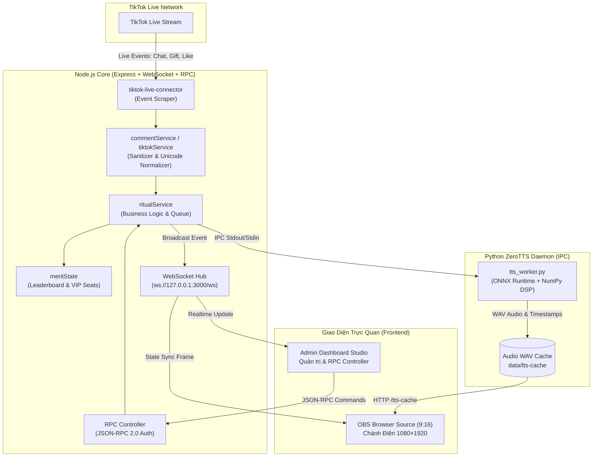

# 🪷 Tam Thế Studio — TikTok Live Interactive 9:16 Temple Sanctuary

[](https://nodejs.org/)
[](https://expressjs.com/)
[](https://github.com/websockets/ws)
[](https://vitejs.dev/)
[](https://www.typescriptlang.org/)
[](https://www.python.org/)
[](https://github.com/astral-sh/uv)
[](https://huggingface.co/zeroweight-ai/ZeroTTS)
[](https://obsproject.com/)

**Tam Thế Studio** là hệ thống phát sóng trực tiếp tương tác tâm linh Phật giáo thời gian thực (**Interactive TikTok Live Stream & JSON-RPC 2.0**) chuẩn khung hình dọc **9:16 (`1080×1920`)** chuyên biệt cho **OBS Studio** và **TikTok Live Studio**. Hệ thống vận hành trên nền tảng **Node.js + Vite + TypeScript**, tích hợp tiến trình AI độc lập **ZeroTTS** đọc sớ, lời khấn và giải quẻ bằng tiếng Việt đa vùng miền hoàn toàn tự động.

Người xem trên TikTok tương tác qua **Thả tim (Like)**, **Bình luận (Comment)**, **Theo dõi / Chia sẻ (Follow / Share)**, và **Tặng quà (Gift)** để kích hoạt các nghi thức trang nghiêm tại Chánh Điện **Đức Phật A Di Đà**.

Xem [hướng dẫn vận hành Live](docs/live-operations.md) để thiết lập quyền phát, token, âm thanh, phòng giả lập và dữ liệu thử. Connector là thư viện không chính thức để nhận sự kiện; tài khoản vẫn cần quyền phát phù hợp của TikTok. Các kiểm tra tự động dùng dữ liệu mẫu, chưa thay thế một buổi thử TikTok thật trên thiết bị người xem.

### Hồ sơ Live

Studio có hai hồ sơ độc lập, dùng chung bộ máy TikTok Live, OBS và ZeroTTS:

| Hồ sơ | Quản lý | Nguồn Live / OBS | Tài nguyên và dữ liệu |
| --- | --- | --- | --- |
| Phật giáo | `/admin?profile=phat-giao` | `/?profile=phat-giao` | `public/assets/phat-giao/`, trạng thái cũ trong `data/merit-state.json` |
| Thiên Chúa giáo | `/admin?profile=thien-chua-giao` | `/?profile=thien-chua-giao` | `public/assets/thien-chua-giao/`, dữ liệu trong `data/profiles/thien-chua-giao/` |

Thêm `&obs=1` vào đường dẫn Live để mở khung sạch cho OBS Browser Source. Ảnh nền tải lên và danh sách trạng thái của từng hồ sơ được lưu riêng. Mỗi thời điểm chỉ một hồ sơ giữ kết nối tới phòng TikTok để tránh xử lý trùng sự kiện.

Hồ sơ Thiên Chúa giáo có tab **Nội dung & giọng đọc**: [100 lời suy ngẫm theo 10 chủ đề](docs/christian-reflections.md), chọn ngẫu nhiên tránh lặp, chỉnh lời và nghe thử bằng cùng cài đặt ZeroTTS trước khi chia sẻ lên Live.

---

## 🛠️ Danh Mục Frameworks & Công Nghệ Sử Dụng (Tech Stack)

Hệ thống được thiết kế theo mô hình lai (Hybrid Architecture) kết hợp giữa Node.js hiệu năng cao, tiến trình Python xử lý AI cục bộ và giao diện WebGL/Canvas siêu nhẹ cho OBS:

### 1. Backend & Networking Runtime
* **[Node.js](https://nodejs.org/) (`>= 20.19` hoặc `>= 22.12`)**: Môi trường runtime chính, non-blocking I/O, quản lý tiến trình con (child process) và vòng đời hệ thống.
* **[Express.js](https://expressjs.com/) (v4.19)**: HTTP web server phục vụ Static Assets, REST API endpoints, Controller xử lý nghiệp vụ, Middleware bảo mật CORS và Rate Limiting.
* **[ws](https://github.com/websockets/ws) (v8.18)**: Engine WebSocket thuần tốc độ cao, hỗ trợ đồng bộ hóa trạng thái hai chiều (Bi-directional Real-time Sync) giữa TikTok, Dashboard Admin và màn hình OBS.
* **[JSON-RPC 2.0 Protocol](https://www.jsonrpc.org/specification)**: Chuẩn giao thức điều khiển đồng nhất trên cả hai kênh **HTTP (`POST /rpc`)** và **WebSocket (`ws://127.0.0.1:3000/ws`)**, có xác thực Bearer Token.
* **[tiktok-live-connector](https://github.com/zerodytrash/TikTok-Live-Connector) (v2.1)**: Thư viện kết nối WebSocket trực tiếp đến hạ tầng TikTok Live để thu thập sự kiện phòng live (chat, like, gift, member join, share, follow) mà không cần session cookie rườm rà.

### 2. Frontend & Build Tooling
* **[Vite](https://vitejs.dev/) (v8.3)**: Dev server HMR (Hot Module Replacement) siêu tốc, quản lý Multi-Page App (`index.html` và `admin/index.html`), đóng gói production với Rolldown/Rollup engine.
* **[TypeScript](https://www.typescriptlang.org/) (v5.8+)**: Kiểm tra kiểu dữ liệu nghiêm ngặt (`typecheck`), tái cấu trúc module hướng đối tượng cho toàn bộ logic client và render canvas.
* **HTML5 Canvas 2D (Offscreen Canvas Engine)**: Bộ dựng hiệu ứng hạt (hương trầm, cánh hoa sen, tiền công đức, mưa hào quang) với kỹ thuật pre-render và giới hạn vẽ **30 FPS**. Mức sử dụng CPU phụ thuộc thiết bị và lượng hiệu ứng đang chạy.
* **CSS3 Custom Design System & GPU Acceleration**: Giao diện mang tông màu ấm truyền thống (*Ngà voi `#f6f2e9`*, *Gỗ trầm `#352c23`*, *Đồng thau `#785c2e`*, *Chu sa `#752e27`*). Khử triệt để giật khung hình nhờ `will-change: transform`, `transform: translate3d` và nạp sẵn sprite vào VRAM GPU.

### 3. AI Neural Voice (Text-to-Speech)
* **[Python](https://www.python.org/) (`3.10+`)**: Môi trường chạy mô hình suy luận âm thanh độc lập.
* **[Astral uv](https://github.com/astral-sh/uv)**: Trình quản lý gói Python thế hệ mới viết bằng Rust, khóa version với `uv.lock`, tự động thiết lập và đồng bộ virtualenv `.venv` trong vài giây.
* **[ZeroTTS](https://huggingface.co/zeroweight-ai/ZeroTTS) (v0.1.5)**: Mô hình mạng nơ-ron tổng hợp giọng nói tiếng Việt tự nhiên phát triển bởi zeroweight-ai, chạy qua ONNX Runtime, hỗ trợ 8 giọng đọc truyền cảm đa vùng miền.
* **[NumPy](https://numpy.org/)**: Xử lý tín hiệu số (DSP), khử DC offset, chuẩn hóa biên độ âm đỉnh (`soft peak <= 0.90`) và làm mượt hai đầu sóng âm bằng hàm cosine (`fade-in / fade-out`) loại bỏ tiếng lách tách (click/pop).

### 4. Live Streaming & Production Engine
* **[OBS Studio](https://obsproject.com/) / [TikTok Live Studio](https://www.tiktok.com/studio/download)**: Tích hợp qua Browser Source chuẩn dọc 9:16 (`1080×1920`), tương thích phần cứng tăng tốc đồ họa (Hardware Acceleration).
* **Web Audio API**: Bộ giải mã và phát âm thanh đa luồng, hỗ trợ cơ chế giảm âm thông minh (**Audio Ducking** - tự động hạ nhạc thiền nền khi giọng đọc AI bắt đầu vang lên).

---

## 🏛️ Sơ Đồ Kiến Trúc Hệ Thống (Architecture Flow)



---

## ✨ Các Tính Năng Nổi Bật

### 1. Diễn Hoạt Nhân Vật 8 Khung Hình Khớp Xương (Zero-Flicker Sprite Stack)
* Nhân vật Phật tử sải bước chân dọc thảm đỏ hoa sen tiến lên trước Lư Hương Đỉnh Đồng, hạ gối quỳ xuống bồ đoàn và thực hiện đầy đủ nghi thức **Tam Bái (Ngũ thể đầu địa - 3 lạy trán chạm đệm)**.
* 8 tư thế được nạp sẵn vào VRAM: `walk1`, `walk2`, `kneelDown`, `kneel`, `forehead`, `bowMid`, `prostrate`, `prostrateDeep`. Bóng đổ được tính toán sẵn trong ảnh PNG, chuyển động tức thì 0ms, không lag giật trên OBS.

### 2. Đạo Tràng 200 Chỗ Ngồi & 6 Đệm Quỳ VIP Gấm Đỏ
* **194 Chỗ Thường**: Chia đều 2 bên chánh điện, tự động hiển thị Avatar thật của người xem TikTok khi họ bình luận hoặc tương tác.
* **6 Vị Trí VIP Bảng Vàng**: 6 đệm gấm đỏ thêu hoa sen vàng ngay trước Phật đài, vinh danh trực tiếp Top 6 thí chủ có điểm Công Đức cao nhất trong buổi phát sóng.
* **Làn Sóng Đạo Tràng**: Mỗi khi có tiếng chuông đại hồng chung hoặc đại lễ, toàn bộ hàng trăm Phật tử trên sàn gỗ đồng loạt cúi lạy tạo hiệu ứng uy nghiêm, xúc động.

### 3. Đọc Sớ & Lời Khấn Tự Động Bằng AI (ZeroTTS 8 Giọng Đọc)
* 8 giọng đọc AI tiếng Việt chân thực: *Bảo Trang, Gia Huy, Hà My, Hữu Đức, Kim Oanh, Mai Chi, Quang Minh, Tiến Đạt*.
* Hỗ trợ chế độ **Luân phiên giọng đọc**: Mỗi tương tác sử dụng một giọng kế tiếp nhau, tạo cảm giác như có nhiều vị Phật tử cùng đọc lời khấn.
* Hệ thống 30 câu dẫn nghi thức sáng tác riêng biệt cho từng hành động tâm linh.

### 4. Xin Xăm / Gieo Quẻ Đầu Năm (100 Thẻ Chiêm Nghiệm)
* Bộ 100 quẻ chiêm nghiệm Phật giáo nguyên bản chia đều theo 5 chủ đề: *Bình an, Tài lộc, Gia đạo, Trí tuệ, Duyên lành*.
* Hiệu ứng lắc ống xăm tre kèm âm thanh sống động; tờ Giải Quẻ tự động bung mở đồng bộ chính xác với thời điểm giọng đọc AI cất lên.

### 5. Bộ Lọc Bảo Mật & Khử Spam Cấp Cao
* **Sanitizer Chống Crash OBS**: Tự động loại bỏ hoàn toàn ký tự nêm Cuneiform (`𒐫`), chữ Ả Rập gây tràn bộ đệm, mã Zalgo, Braille, bình luận toàn dấu chấm (`...`) hoặc từ ngữ phản cảm.
* **Unicode Normalization**: Chuyển đổi mã Unicode phức tạp (`NFKC` $\rightarrow$ `NFC`), đưa tên kiểu chữ nghệ thuật về chữ cái tiếng Việt chuẩn trước khi chuyển sang mô hình TTS.
* **Cơ Chế Giảm Tải**: Hàng đợi (queue) giới hạn 12 mục cùng cooldown 3.5s/người giúp buổi Live không bao giờ bị nghẽn lệnh.

---

## 🎮 Bảng Quy Tắc Tương Tác TikTok Live

| Sự kiện TikTok Live | Điều kiện / Từ khóa nhận diện | Nghi thức tương ứng trên Chánh Điện | Điểm Công Đức |
| :--- | :--- | :--- | :---: |
| **Thả tim (Like)** | Từng đợt like từ người xem | Gõ mõ gỗ trầm tụng kinh + Làn sóng Phật tử vái lạy | `+1` / tim |
| **Theo dõi (Follow) / Chia sẻ (Share)** | Thao tác follow hoặc share buổi live | Thỉnh Đại Hồng Chung ngân vang + Tỏa sóng âm vàng | `+10` |
| **Bình luận Thắp hương** | `thắp hương`, `dâng hương`, `bái phật`, `lạy phật`, `hương` | Phật tử bước lên thảm đỏ, quỳ đảnh lễ 3 lạy + Đọc tên & lời khấn | `+15` |
| **Bình luận Cầu nguyện** | `cầu ...`, `nguyện ...`, `nam mô`, `a di đà phật`, `bình an`, `chúc ...` | Bước lên đảnh lễ + Thả Đèn Hoa Đăng mang sớ khấn bay lên trời | `+10` |
| **Bình luận Xin xăm** | `xin xăm`, `gieo quẻ`, `rút quẻ`, `quẻ` | Lắc ống xăm tre + Mở tờ Giải Quẻ đồng bộ giọng đọc AI | `+10` |
| **Tặng quà Nhỏ (1–4 xu)** | Hoa hồng, Heart Me, Nốt nhạc... | Dâng Đài Hoa Sen Vàng + Thắp 3 nén hương + Đọc cảm tạ | `+20` / xu |
| **Tặng quà Vừa (5–99 xu)** | Đèn lưu ly, Mâm ngũ quả, Chuông gió... | Dâng Mâm Quả / Đèn Lưu Ly + Thỉnh chuông đồng ngân vang | `+30` / xu |
| **Tặng quà Lớn ($\ge$ 100 xu)** | Quà đặc biệt $\ge$ 100 xu | **Đại Lễ Kim Long Chầu Phật**: Mưa hoa sen vàng, Hào quang vạn trượng, Chuông ngân vang | `+50` / xu |

---

## 🚀 Hướng Dẫn Cài Đặt & Vận Hành

### 1. Yêu Cầu Hệ Thống
* **Hệ điều hành**: Windows 10/11, macOS, hoặc Ubuntu Linux.
* **Node.js**: Phiên bản `>= 20.19.0` hoặc `>= 22.12.0` (khuyên dùng Node.js 22 LTS).
* **Python**: Phiên bản `3.10+` kèm công cụ [`uv`](https://github.com/astral-sh/uv).
* **OBS Studio**: Bản 29+ (khuyên dùng bản 30+).

### 2. Cài Đặt Trong 1 Bước
Mở terminal tại thư mục dự án và chạy:

```bash
npm install
```
> Lệnh `npm install` sẽ tự động kích hoạt script `setup-python.mjs`, tải và đồng bộ môi trường ảo `.venv` cùng toàn bộ thư viện Python thông qua `uv.lock`.

*(Tùy chọn trên Windows PowerShell: Bạn có thể chạy script `.\setup.ps1` để tự động kiểm tra và cấu hình toàn bộ).*

### 3. Tải Model Giọng Đọc ZeroTTS
ZeroTTS hỗ trợ tải model đã ghim revision trực tiếp từ Hugging Face Hub:

* **Trên Windows PowerShell**:
  ```powershell
  $env:ZEROTTS_ALLOW_HUB_DOWNLOAD = "1"
  npm start
  ```
* **Trên macOS / Linux**:
  ```bash
  ZEROTTS_ALLOW_HUB_DOWNLOAD=1 npm start
  ```
Model (`~900 MB`) sẽ được lưu vào cache cục bộ `data/models/` cho các lần chạy sau mà không cần tải lại.

### 4. Khởi Chạy Hệ Thống

#### Chế độ Phát triển (Development - Hot Reload):
Chạy đồng thời Backend Node.js, Frontend Vite và AI Voice Worker:
```bash
npm run dev
```
* Giao diện Live xem trước: [http://127.0.0.1:5173](http://127.0.0.1:5173)
* Bảng điều khiển Admin Studio: [http://127.0.0.1:5173/admin](http://127.0.0.1:5173/admin)

#### Chế độ Vận hành Thực tế (Production):
Build giao diện tối ưu hóa và khởi chạy server production:
```bash
npm start
```
* **Màn hình OBS Browser Source**: [http://127.0.0.1:3000/?obs=1](http://127.0.0.1:3000/?obs=1)
* **Màn hình Điều khiển & Giám sát**: [http://127.0.0.1:3000](http://127.0.0.1:3000)
* **Bảng Quản trị Admin**: [http://127.0.0.1:3000/admin](http://127.0.0.1:3000/admin)

---

## 🎥 Hướng Dẫn Tích Hợp Vào OBS Studio

1. Mở **OBS Studio**, tạo một Scene mới.
2. Trong hộp **Sources**, bấm dấu **`+`** $\rightarrow$ chọn **Browser** (Trình duyệt).
3. Đặt các thông số cấu hình như sau:
   * **URL**: `http://127.0.0.1:3000/?obs=1` *(hoặc kèm token: `http://127.0.0.1:3000/?obs=1#token=<RPC_TOKEN>`)*.
   * **Width**: `1080`
   * **Height**: `1920`
   * **Control audio via OBS**: Đánh dấu tích chọn (để điều chỉnh âm lượng Chánh Điện trực tiếp trên bàn mixer của OBS).
   * **Shutdown source when not visible**: Bỏ chọn (để duy trì kết nối liên tục khi chuyển scene).
4. Bấm **OK**. Sân khấu Chánh Điện 9:16 sẽ hiển thị vừa khít khung dọc livestream TikTok.

---

## 🔌 Đặc Tả Giao Thức JSON-RPC 2.0

Server hỗ trợ đầy đủ các lệnh điều khiển thông qua chuẩn JSON-RPC 2.0 có xác thực `Authorization: Bearer <RPC_TOKEN>`.

### Ví dụ gọi lệnh qua cURL:

#### 1. Thắp hương & Đọc lời khấn:
```bash
curl -X POST http://127.0.0.1:3000/rpc \
  -H "Content-Type: application/json" \
  -H "Authorization: Bearer <RPC_TOKEN>" \
  -d '{
    "jsonrpc": "2.0",
    "id": 1,
    "method": "temple.burnIncense",
    "params": {
      "user": "Thí Chủ Minh Tâm",
      "count": 3,
      "wish": "Cầu gia đạo bình an, sức khỏe dồi dào, vạn sự hanh thông"
    }
  }'
```

#### 2. Gieo quẻ xin xăm:
```bash
curl -X POST http://127.0.0.1:3000/rpc \
  -H "Content-Type: application/json" \
  -H "Authorization: Bearer <RPC_TOKEN>" \
  -d '{
    "jsonrpc": "2.0",
    "id": 2,
    "method": "temple.drawFortune",
    "params": {
      "user": "Phật tử Diệu Thiện",
      "topic": "Cầu bình an và công danh sự nghiệp"
    }
  }'
```

#### 3. Kết nối phòng TikTok Live:
```bash
curl -X POST http://127.0.0.1:3000/rpc \
  -H "Content-Type: application/json" \
  -H "Authorization: Bearer <RPC_TOKEN>" \
  -d '{
    "jsonrpc": "2.0",
    "id": 3,
    "method": "live.connect",
    "params": {
      "username": "@tai_khoan_tiktok"
    }
  }'
```

### Danh Sách Các Phương Thức Hỗ Trợ:
* `temple.getState`: Truy xuất toàn bộ dữ liệu trạng thái Chánh Điện và bảng xếp hạng.
* `temple.burnIncense`: Kích hoạt đảnh lễ thắp hương (`user`, `avatar`, `count`, `wish`).
* `temple.sendPrayer`: Thả đèn hoa đăng cầu an (`user`, `avatar`, `wish`).
* `temple.drawFortune`: Lắc xăm và gieo quẻ chiêm nghiệm (`user`, `avatar`, `topic`).
* `temple.strikeWoodenFish`: Gõ mõ tụng kinh (`user`, `count`).
* `temple.ringBell`: Thỉnh Đại Hồng Chung (`user`, `count`, `wish`).
* `temple.offerGift`: Dâng cúng vật phẩm (`user`, `giftType`, `coins`, `giftName`).
* `temple.grandCeremony`: Kích hoạt Đại Lễ Kim Long Chầu Phật (`user`, `coins`, `giftName`).
* `temple.updateSettings`: Cập nhật âm lượng nhạc nền, âm lượng giọng đọc, cấu hình danh sách giọng.
* `temple.resetMerit`: Đặt lại bảng thống kê Công Đức.
* `live.connect` / `live.disconnect`: Quản lý kết nối luồng TikTok Live.

---

## 📂 Cấu Trúc Thư Mục Dự Án

```text
tiktok-live-temple-rpc/
├── package.json                 # Cấu hình dự án Node.js, dependencies & scripts
├── vite.config.mjs              # Cấu hình Vite MPA server, proxy & rolldown
├── tsconfig.json                # Cấu hình TypeScript compiler
├── pyproject.toml               # Khai báo dependency Python (ZeroTTS)
├── uv.lock                      # Khóa phiên bản gói Python mã hóa SHA256
├── tts_worker.py                # Tiến trình daemon Python AI ZeroTTS thường trú
├── server.js                    # Entry point khởi động ứng dụng
├── start.ps1 / setup.ps1        # Script tự động hóa khởi động & cài đặt trên Windows
│
├── src/                         # Mã nguồn cốt lõi hệ thống
│   ├── app.js                   # Cấu hình Express application & static routing
│   ├── server.js                # Khởi tạo HTTP Server, WebSocket Hub & Worker IPC
│   ├── config.js                # Biến môi trường, port, host & path configs
│   ├── controllers/             # Bộ điều phối HTTP, RPC, State, TTS & WebSocket
│   ├── middleware/              # Xác thực Token, CORS, Rate-limit & Body parser
│   ├── models/                  # Quản lý State công đức (in-memory & json storage)
│   ├── services/                # Dịch vụ nghi thức, TikTok scraper, TTS, Audio
│   │   ├── ritualService.js     # Xử lý chuỗi nghi thức thắp hương, thả hoa đăng, gieo quẻ
│   │   ├── tiktokService.js     # Lắng nghe & chuyển tiếp sự kiện TikTok Live
│   │   ├── commentService.js    # Phân tích cú pháp lời bình luận & sớ khấn
│   │   ├── ttsService.js        # Giao tiếp IPC với Python worker, quản lý hàng đợi âm thanh
│   │   └── realtimeService.js   # Điều phối phát sóng WebSocket tới OBS và Admin
│   ├── data/
│   │   └── fortuneDeck.js       # Bộ dữ liệu 100 quẻ chiêm nghiệm Phật giáo
│   ├── utils/                   # Bộ lọc ký tự rác, chuẩn hóa Unicode & tên người xem
│   └── views/                   # Giao diện người dùng (Frontend)
│       ├── index.html           # View Chánh Điện 9:16 (Overlay phát sóng OBS)
│       ├── admin/index.html     # View Bảng điều khiển Studio Quản trị
│       └── scripts/             # TypeScript modules
│           ├── live.ts          # Logic Chánh Điện: 200 chỗ, di chuyển thảm đỏ, lạy Tam Bái
│           ├── particles.ts     # Canvas 2D Particle Engine hiệu năng cao (30 FPS)
│           ├── adminEntry.ts    # Logic bảng điều khiển Admin Studio
│           └── liveCardPreviews.ts
│
├── public/                      # Static assets tĩnh
│   ├── assets/                  # Ảnh nền Chánh Điện, sprite nhân vật áo lam 8 pose
│   │   ├── music/               # 6 bản nhạc thiền ambient tổng hợp (WAV 48s)
│   │   ├── devotee.png          # Sprite nhân vật quỳ chắp tay
│   │   ├── devotee_walk.png     # Sprite bước chân 1 & 2
│   │   └── devotee_prostrate.png# Sprite cúi lạy sát đất
│   └── css/                     # Stylesheet tùy biến theo hệ thống thiết kế Studio
│
├── scripts/                     # Tooling scripts hỗ trợ
│   ├── dev.mjs                  # Script chạy song song Node backend & Vite dev server
│   ├── setup-python.mjs         # Script tự động đồng bộ uv Python
│   └── test-studio.cjs          # Bộ kiểm thử tích hợp (Integration Tests)
│
└── data/                        # Runtime database & cache âm thanh (Được ignore khỏi Git)
    ├── tts-cache/               # Cache file âm thanh WAV đã tổng hợp từ ZeroTTS
    └── models/                  # Thư mục chứa trọng số model ZeroTTS cục bộ
```

---

## 📜 Giấy Phép & Bản Quyền

Dự án phát triển phục vụ mục đích xây dựng không gian trực tuyến trang nghiêm, thanh tịnh cho cộng đồng Phật tử và người mến mộ đạo Phật trên nền tảng phát trực tiếp TikTok Live. Toàn bộ hình ảnh, âm thanh và lời dẫn được biên soạn theo tinh thần từ bi, hướng thiện.
